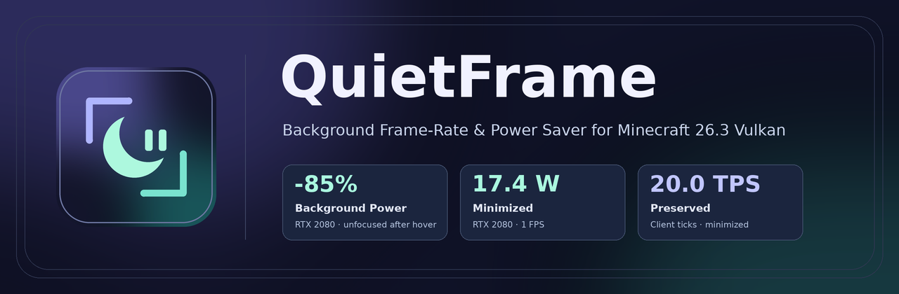

# QuietFrame


[](LICENSE)


QuietFrame reduces rendering work and GPU board power when Minecraft 26.3 is unfocused, minimized or idle. It caps rendering at 10 FPS when unfocused, 1 FPS when minimized, and 15 FPS after 60 seconds of inactivity by default. Hovering over an unfocused window restores normal render pacing while audio stays attenuated. Keyboard or mouse input wakes an idle client. The client continues servicing input, game ticks and rendering tasks between frames. Minecraft's own pause-on-focus-loss setting still applies by default.

## Install

Use **Minecraft 26.3** with the **Vulkan** renderer, **Java 25** or newer, **Fabric Loader 0.19.5** or newer, and **Fabric API 0.164.0** or newer for Minecraft 26.3. Place `quietframe-0.1.0.jar` and Fabric API in the client instance's `mods/` directory. QuietFrame works in singleplayer and when joining multiplayer servers. [GitHub Releases](https://github.com/bejulian1/quietframe/releases)

## Live RTX 2080 Vulkan benchmark

The `r4-rtx2080` run used an AMD Ryzen 7 2700X, a GeForce RTX 2080 with NVIDIA Vulkan driver 610.43.02, Java 25, Fabric Loader 0.19.5 and Fabric API 0.164.0+26.3. Each of the four profiles ran in a fresh client on a GNOME Wayland desktop using SDL's X11 backend through XWayland. Each launch used the same seed-263 singleplayer courtyard, fixed camera, 1280×720 window, paused daylight clock and ambient beacon loop. VSync and pause on focus loss were off. The observer scored 10-second windows and used a 55-second AFK timeout. The Daylight profiles used the same shader pack and fixed shader clock.

FPS counts successful application presents per second. TPS counts client ticks per second. Power is the sampled NVIDIA GPU board draw, including desktop activity. OpenAL `AL_GAIN` is the observed listener gain, shown as a range when it varied. Each cell is **control → QuietFrame**, with numeric readings kept at the source CSV precision. An em dash indicates a missing observation or an invalid paired power comparison. Rows marked failed retain the observed values for diagnosis. The run used the 1 FPS minimized mode. The optional `skip_render_when_minimized` mode instead suspends rendering for hidden or minimized windows and submits offscreen Vulkan work on a 250 ms cadence to retire fences. [Benchmark runner and methodology](bench/README.md)

### Vanilla client with and without QuietFrame

The control runs Minecraft with Fabric API and the benchmark observer.

| Phase | FPS | Client TPS | GPU board W | OpenAL gain | Phase status | Paired board power |
| --- | ---: | ---: | ---: | ---: | --- | ---: |
| Focused | 2529.0 → 2452.0 | 20.0 → 20.0 | 108.50617664460698 → 112.392078470135 | 1.0 → 1.0 | ok → ok | 3.5812724636456554% |
| Unfocused | 2537.7 → 10.0 | 20.0 → 20.0 | 110.589126028163 → 24.885574519686 | 1.0 → 0.25 | ok → ok | -77.49726811897531% |
| Hover wake | 2489.8 → 2641.5 | 20.0 → 20.0 | 106.958962416376 → 113.160973716944 | 1.0 → 0.25 | ok → ok | 5.79849613389522% |
| Unfocused after hover | 2536.2 → 10.0 | 20.0 → 19.9 | 108.62579004030799 → 25.704638630185002 | 1.0 → 0.25 | ok → ok | -76.33652319523132% |
| Minimized | 10.0 → 1.0 | 20.0 → 20.0 | 28.484900894964003 → 15.970673014339999 | 1.0 → 0.0 | ok → ok | -43.93284683267569% |
| Restored | 2678.3 → 695.4 | 20.0 → 19.9 | 112.651385692781 → 50.86857451664199 | 1.0 → 0.25–1.0 | ok → failed | — |
| AFK | — → 15.0 | — → 20.0 | — → 30.009690596497 | — → 1.0 | unsupported → ok | — |
| Input wake | — → 517.8 | — → 19.9 | — → 43.327600884697 | — → 0.25–1.0 | unsupported → failed | — |

### Full 8-mod Daylight stack with and without QuietFrame

The control runs the seven companion mods with the Daylight shader enabled. The treatment adds QuietFrame as the eighth mod, alongside Fabric API and the benchmark observer. [Compatibility table](#compatibility)

| Phase | FPS | Client TPS | GPU board W | OpenAL gain | Phase status | Paired board power |
| --- | ---: | ---: | ---: | ---: | --- | ---: |
| Focused | 813.5 → 827.1 | 20.0 → 20.0 | 161.109962038032 → 172.04506819419802 | 1.0 → 1.0 | ok → ok | 6.787355677971461% |
| Unfocused | 796.5 → 10.0 | 19.9 → 20.0 | 163.656910311682 → 27.060240376945 | 1.0 → 0.25 | ok → ok | -83.46526258780689% |
| Hover wake | 822.5 → 824.2 | 20.0 → 20.0 | 167.611966344753 → 165.77355295426798 | 1.0 → 0.25 | failed → ok | — |
| Unfocused after hover | 819.9 → 10.0 | 20.0 → 20.0 | 160.63122240482002 → 23.772883338350002 | 1.0 → 0.25 | ok → ok | -85.20033466567415% |
| Minimized | 10.0 → 1.0 | 20.1 → 20.0 | 24.478364884493 → 17.431459800778 | 1.0 → 0.0 | ok → ok | -28.78829985976392% |
| Restored | 829.6 → 835.2 | 19.9 → 19.9 | 171.97686852381798 → 169.634177943322 | 1.0 → 1.0 | failed → ok | — |
| AFK | 838.6 → 15.0 | 20.0 → 20.0 | 175.208615831205 → 27.521009060258002 | 1.0 → 1.0 | failed → ok | — |
| Input wake | 839.6 → 808.9 | 19.9 → 20.0 | 175.97376671409302 → 167.87345526296002 | 1.0 → 1.0 | failed → ok | — |

### Verification and limits

The banner rounds the Daylight stack's valid unfocused-after-hover power change from **−85.20033466567415%** to **−85%**. Its minimized arm measured **17.431459800778 W** at **1.0 FPS** and **20.0 client TPS**. Exact phase readings and paired power changes come from `bench/build/runs/r4-rtx2080/summary.csv` and `paired.csv`.

| Check | Vanilla control → QuietFrame | Daylight control → QuietFrame |
| --- | --- | --- |
| Within each arm, focused capture before blur vs. focused capture after restore | 0 → 0 changed RGBA pixels | 0 → 0 changed RGBA pixels |
| Across arms, matching before and after captures | 0 changed RGBA pixels before and after | 0 changed RGBA pixels before and after |
| `options.txt` within each launch | Byte-identical at canonical, before-save, after-save, focused recovery and exit | Byte-identical at the same five checkpoints |

Screenshot comparisons decode all four RGBA channels at 1280×720. Each profile uses its own canonical options file. The blur-phase save also preserved the sampled listener gain and looping sound in all four launches. The observer wrote the screenshot and options verdicts to `comparisons.json` and the per-launch `result.json` files.

The vanilla control timed out establishing AFK, so its wake phase was also unsupported. Vanilla with QuietFrame failed restoration and input-wake checks for SDL state or gameplay and for listener gain or looping sound. The Daylight control failed the hover SDL state or gameplay check and the restore, AFK and wake listener gain or looping sound checks. All eight Daylight treatment phases passed their individual checks. This single repetition describes the measured fixture. The paired table includes power changes only where both phases passed.

## Configuration

QuietFrame creates `config/quietframe.json` in the instance directory. Edit the file and run `/quietframe reload` in-game, or restart the client. Missing keys use the defaults below. An invalid reload leaves the current settings active. Invalid settings at startup fall back to defaults and log the error.

| Key | Default | Accepted values and behavior |
| --- | --- | --- |
| `enabled` | `true` | Boolean. Enables QuietFrame. |
| `unfocused_fps` | `10` | Integer 1–260. Render cap when unfocused with the pointer outside. |
| `minimized_fps` | `1` | Integer 1–260. Render cap when minimized, hidden, or unfocused in exclusive fullscreen. |
| `afk_enabled` | `true` | Boolean. Enables the inactivity cap. |
| `afk_timeout_seconds` | `60` | Integer 1–86,400. Seconds since the last vanilla input or window wake. |
| `afk_fps` | `15` | Integer 1–260. Render cap while idle. |
| `hover_wakeup` | `true` | Boolean. Restores normal render pacing while the pointer is over an unfocused window. |
| `skip_render_when_minimized` | `false` | Boolean. Suspends rendering when SDL reports the game window minimized or hidden. |
| `audio_attenuation` | `true` | Boolean. Enables temporary OpenAL listener attenuation. |
| `unfocused_volume_multiplier` | `0.25` | Number 0–1. Multiplies listener gain whenever the visible window lacks keyboard focus, including hover. |
| `minimized_volume_multiplier` | `0.0` | Number 0–1. Multiplies listener gain while minimized or hidden. Zero mutes the listener. |
| `show_status_badge` | `false` | Boolean. Shows QuietFrame state and the active cap on the in-game HUD. F2 captures omit the badge. |
| `pause_on_lost_focus_override` | `false` | Boolean. When enabled, suppresses automatic pause on focus loss while QuietFrame is active. |

Custom render caps respect a lower Minecraft frame limit. QuietFrame stores its own settings in its JSON file. Minecraft handles key bindings in `options.txt`.

### Commands and keybind

| Command | Effect |
| --- | --- |
| `/quietframe` or `/quietframe status` | Show current state, bypass reason, requested and effective caps, and applied audio multiplier. |
| `/quietframe toggle` | Toggle QuietFrame and save the new setting. |
| `/quietframe reload` | Read the JSON settings from disk. |
| `/quietframe profile` | List the available profiles. |
| `/quietframe profile balanced` | Save 10 unfocused FPS, 1 minimized FPS, 60 seconds to AFK, 15 AFK FPS, 0.25 unfocused gain and 0 minimized gain. |
| `/quietframe profile quiet` | Save 5 unfocused FPS, 1 minimized FPS, 60 seconds to AFK, 10 AFK FPS, 0.10 unfocused gain and 0 minimized gain. |

**Toggle QuietFrame** is unbound by default. Assign it under **Options → Controls → Key Binds → QuietFrame**.

## Compatibility

The Daylight benchmark loaded the seven companion mods below together. The phase results above describe the combined fixture.

| Mod | Version or ID | QuietFrame behavior |
| --- | --- | --- |
| Sodium | 0.9.3-beta.1+mc26.3 | Both Daylight arms used this renderer optimization. |
| Lithium | 0.26.2+mc26.3 | Both Daylight arms used this game-logic optimization. |
| FerriteCore | 9.0.0 | Both Daylight arms used this memory optimization. |
| Lightshade | 0.0.1 | Loaded the Daylight shader in both stack arms. |
| SwiftDraw | 0.1.0 | Loaded in both Daylight arms. |
| TickSight | 0.1.0 | Loaded in both Daylight arms. |
| LuxStride | 0.1.0 | Loaded in both Daylight arms. |
| Dynamic FPS | `dynamic_fps` | QuietFrame yields automatically at startup. |
| FPS Reducer | `fpsreducer` | QuietFrame yields automatically at startup. |

## Build and test

Use Python 3.11+ and a JDK 25. Launch Minecraft 26.3 with Fabric Loader 0.19.5 in Prism Launcher to populate the pinned dependencies. Install `fabric-api-0.164.0+26.3.jar` in that instance or place it in the project's `libs/` directory. Set `JAVA_HOME` to select a JDK, `QUIETFRAME_PRISM_CACHE` for a custom Prism data directory, or `QUIETFRAME_MODS` for a custom Fabric API directory.

```sh
python3 tools/build.py
python3 tools/test.py
```

The build writes `build/quietframe-0.1.0.jar`. The verification script checks the archive, rebuilds classes independently, runs Java unit tests, and tests Mixin application and conflict gating under Fabric Knot. [Architecture](docs/ARCHITECTURE.md) · [Contributing](CONTRIBUTING.md)

## License

QuietFrame is released under the [MIT License](LICENSE).
